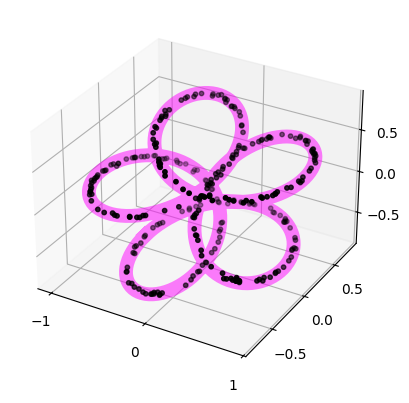
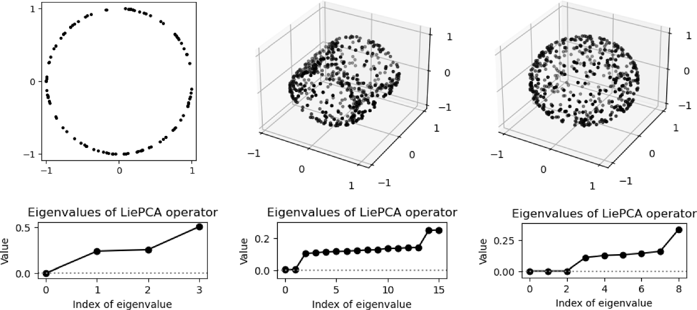

:orphan:

.. To get rid of WARNING: document isn't included in any toctree

LieDetect user manual
=====================

.. include:: liedetect_sum.inc

A representation of a Lie group :math:`G` on :math:`\mathbb{R}^n` is a group homomorphism
:math:`\rho:G\to GL(n,\mathbb{R})` mapping each group element to a :math:`n\times n` real matrix.

Given a point :math:`x_0\in\mathbb{R}^n`, its orbit under the representation is the set of points
:math:`x` such that :math:`\rho(g)\cdot x_0 = x` for some :math:`g\in G`.

The representation is called irreducible if :math:`\mathbb{R}^n` has no non-trivial subspaces invariant
under the representation. If :math:`G` is a compact Lie group, any finite-dimensional representation
can be decomposed as a direct sum of irreducible representations. The multiset of parameters
characterizing this decomposition is called the representation type of :math:`\rho`.

Given a point cloud :math:`\{x_i\}` lying on or close to an orbit of a representation
:math:`\rho(g)` of the compact Lie groups :math:`SO(2)`, :math:`T^d`, :math:`SO(3)`,
or :math:`SU(2)`, `LieDetect [Ennes and Tinarrage, 2025]
<https://link.springer.com/article/10.1007/s10208-025-09728-4>`_ estimates the representation
:math:`\rho(g)` in terms of its representation type. This estimate allows reconstruction of the
representation orbit. The algorithm consists of four steps, described below and
detailed in the paper.

   Samples along a :math:`SO(2)` representation orbit in :math:`\mathbb{R}^4`,
   projected to :math:`\mathbb{R}^3` for visualization.

Step 1: Orthonormalization
--------------------------

Every representation of a compact Lie group can be made orthogonal. That is,
there exists a change of basis of :math:`\mathbb{R}^n` for which the orbit lies
on the unit sphere. The first step of LieDetect estimates such a change of basis.

This step is implemented by the :class:`~gudhi.liedetect.Orthonormalize` class.

.. code-block:: python

    from gudhi.liedetect import Orthonormalize

    ortho = Orthonormalize(pts)
    pts = ortho.fit_transform()

The input must have finite real coordinates and full-rank centered covariance.
Integer coordinates are converted to floating point.

This operation is not equivalent to the usual radial projection onto the sphere
obtained by normalization.

Step 2: LiePCA
--------------

The second step uses the LiePCA algorithm of :cite:`cahill2023lie`. Tangent information along
the orbit is used to compute an operator approximating the infinitesimal action
of the representation (i.e., the associated Lie algebra representation).

This functionality is provided by the :class:`~gudhi.liedetect.OrbitFitter` class.

The default uses the raw operator on the full matrix space, following the
operator formulation in the paper. Pass ``compress_to_skew=True`` to use the
skew-to-skew compression and the identity on symmetric matrices. This is an
alternative finite-sample formulation. With compression, the full fitting
objective drops the symmetric part of each residual, and bottom-eigenspace
fitting can select a different subspace. Both bottom-eigenspace methods
still take eigenvectors of the full returned matrix before skew-projecting
them. A tie at eigenvalue one can mix symmetric and skew directions.

The earlier keyword ``correction`` has been renamed to ``compress_to_skew``.
Existing calls that relied on the old default can opt into the repaired
compression explicitly. Calls using the old keyword should use the new name.

.. code-block:: python

    from gudhi.liedetect import OrbitFitter

    orbit_fitter = OrbitFitter(pts=pts)
    lie_pca = orbit_fitter.lie_pca(
        nb_neighbors=nb_neighbors,
        orbit_dim=orbit_dim,
    )

The near-zero eigenvalues estimate the dimension of the full infinitesimal
symmetry algebra of the orbit. It can be larger than the algebra of the
generating group. Set `orbit_dim` to the tangent dimension of the observed
orbit. It equals the dimension of the group minus the dimension of the
stabilizer of the base point. For example, an :math:`SO(3)` sphere orbit has
dimension two.

They can be displayed with

.. code-block:: python

    orbit_fitter.print_lie_pca_eigenvalues()

For example, if the output is

.. code-block:: none

    Lie PCA first eigenvalues: 3.0e-04  1.2e-01  1.4e-01  2.4e-01

the estimated infinitesimal symmetry algebra is one-dimensional.

   LiePCA eigenvalues for groups of dimension 1, 2, and 3, respectively.

Step 3: Optimization
--------------------

In this step, LieDetect estimates a nearby algebra compatible with a valid
representation type. Iterative fitting uses local optimization. Supply
`seed` or `initial_point` for repeatable starts and inspect
`orbit_fitter.fit_diagnostics_` for the selected score and solver stop reason.
Use `reps_to_test` to provide candidate representations directly when the
automatic search is too large.

.. code-block:: python

    _, _ = orbit_fitter.closest_algebra(
        group=group,
        group_dim=group_dim,
        frequency_max=frequency_max,
        method=method,
        verbose=True,
    )

The irreducible decomposition of a compact group representation is unique
up to permutation and equivalence of the summands, with multiplicities.
Different representations can nevertheless generate the same orbit, so orbit
data can leave the underlying representation unidentified. Torus character
weights are integers, whereas Lie-PCA estimates a subspace from floating-point
data. The current torus equivalence check compares numerical invariants.

.. code-block:: python

    from gudhi.liedetect import are_representations_equivalent

    are_representations_equivalent(
        group,
        groundtruth_rep,
        orbit_fitter.representation_type_,
    )

Step 4: Generate orbit and compute Hausdorff distances
------------------------------------------------------

Once the representation type has been estimated, the corresponding orbit can
be reconstructed.

.. code-block:: python

    reconstructed_orbit = orbit_fitter.sample_orbit(nb_points=1000)

The fitter stores two directed Hausdorff distances in order. The first measures
coverage of the data by the reconstruction. The second measures coverage of
the reconstruction by the data and also reflects gaps in the input sampling.

.. code-block:: python

    print("Hausdorff distances:", orbit_fitter.hausdorff_distances_)

Generate synthetic data
-----------------------

LieDetect also provides functions to generate synthetic data near orbits of
representations.

.. code-block:: python

    from gudhi.datasets.linear_orbits import (
        sample_from_lie_group,
        sample_from_lie_group_rep,
    )

    # Choose the Lie group
    pts, rep_type = sample_from_lie_group(
        group="torus",
        ambient_dim=4,
        nb_points=100,
        group_dim=1,
        frequency_max=2,
        seed=1,
    )

    # Choose the representation type
    pts = sample_from_lie_group_rep(
        group="torus",
        rep_type=((1, 2),),
        nb_points=100,
        method="evenly_spaced",
    )

Simple example
--------------

The example below reconstructs a sphere sampled from the standard
:math:`SO(3)` representation.

.. code-block:: python

    from gudhi.datasets.linear_orbits import sample_from_lie_group_rep
    from gudhi.liedetect import OrbitFitter, Orthonormalize

    pts = sample_from_lie_group_rep("SO(3)", (3,), nb_points=300)
    pts = Orthonormalize(pts).fit_transform()

    orbit_fitter = OrbitFitter(pts)
    orbit_fitter.lie_pca(nb_neighbors=15, orbit_dim=2)
    rep_type, _ = orbit_fitter.closest_algebra("SO(3)", seed=1)
    orbit = orbit_fitter.sample_orbit(nb_points=1000, method="evenly_spaced")

    print("Estimated representation:", rep_type)
    print("Data-to-reconstruction distance:", orbit_fitter.hausdorff_distances_[0])
